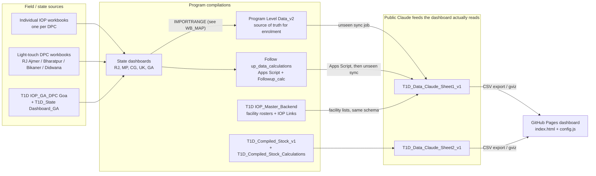

# WJCF T1D Dashboard — Maintenance Runbook

**Audience:** a future assistant (or the maintainer) fixing enrolment numbers, blank feeds, stale months, or chart/code issues.

**Dashboard:** https://wjcfteamt1diabetes.github.io/t1d-dashboard/
**Repo:** https://github.com/wjcfteamt1diabetes/t1d-dashboard
**Owner GitHub account:** `wjcfteamt1diabetes` (personal account; the Cursor GitHub app is installed on it)

**This runbook was built on 17 Nov 2026 (Asia/Calcutta).** Row counts and headline figures below are from that day unless noted. Re-run `/workspace/t1d-runbook/qc_check.sh` before trusting them.

**Safety rules**

- Read-only on sheets unless the maintainer explicitly asks for a write, and then only the tab they named.
- Never change Google sharing (the Claude workbooks are already "Anyone with the link → Viewer"). Ask first.
- Never put patient names, phone numbers, emails, or Unique IDs in tickets, PRs, chat, or this file. Program Level `Unique ID` values are built as state + district + name + phone.
- Claude_IDs (`P1`…`P5000`) are positional placeholders, not clinical identifiers. They are safe to mention (e.g. "P19 has `#ERROR!`").
- Do not push to the repo yourself unless the maintainer asked you to merge. Default path: cloud agent opens a PR; the maintainer merges.

---

## 1. Architecture and data flow

The live dashboard is a static GitHub Pages site. The browser fetches Google Sheets as CSV (or, as a fallback, the gviz visualization endpoint) and aggregates everything client-side. There is no dashboard backend. `apps-script/Code.gs` in the repo is a **deprecated** previous design and is not what the site uses.



**The unseen sync job** is not in the GitHub repo. On **17 Nov 2026** it wiped the live Claude clinical tabs at **12:28 PM IST** and refilled them at **6:27 PM IST**. Treat any "Enrolled List has N rows but only 0 carry patient data" error as this job (or a similar refresh) having blanked the feed mid-run. Hidden tabs named `… backup before synced feeds` on Claude Sheet1 are **stale** (data ends Sep 2026) and are not a safe restore source after the 17 Nov rebuild.

`Program Level Data_v2` tab `WB_MAP` (hidden) documents the intended flow: state dashboards → Program Level enrolment / follow-up → Claude workbook. It also has two date cells: a "DATE" (17 Nov 2026 when inspected) and **"DATE FOR LAST 3 MONTHS CALCULATION" = 31 Jul 2026**. That July cutoff is what Program Level `SMBG_Hyper/Hypo` labels as "Follow-up visits since". The dashboard itself computes "last 3 months" from the browser clock, not from that cell.

---

## 2. Inventory of workbooks and tabs

IDs are Drive file IDs. A `gid` is the tab's `sheetId`. Grid size is the sheet's allocated size, not the number of filled rows. **"Dashboard?"** means `index.html` fetches the tab at runtime.

CSV export URL pattern (works only when the workbook is "Anyone with the link → Viewer"):

```
https://docs.google.com/spreadsheets/d/<ID>/export?format=csv&gid=<GID>
```

gviz fallback (used automatically if `fetch` is blocked):

```
https://docs.google.com/spreadsheets/d/<ID>/gviz/tq?tqx=out:csv&headers=0&sheet=<TabName>
```

### 2.1 Workbooks the dashboard reads (`config.js`)

```javascript
window.DASHBOARD_CONFIG = {
  wb1: '1cgMB5RIomWGSw_cQfmFkxx3qfBXlXxIL9fR4FzFuwIg', // T1D_Data_Claude_Sheet1_v1
  wb2: '1zObGfUcDOszt82v9V65OAK7yV5McXzeusFx5XqU_d6M'  // T1D_Data_Claude_Sheet2_v1
};
```

These two workbooks must stay public (viewer). A non-public workbook returns HTML and the dashboard shows "Sheet … is not public".

**Hard-coded gids** in `fetchTab` (`index.html` ~3511–3513) force CSV export for tabs where gviz drops rows or numeric headers:

| Tab | gid |
|---|---|
| Enrolled List | 0 |
| CompleteSupport_Facilities | 1253968089 |
| Followup_adherence | 733015193 |
| SMBG_Monthly | 1620041867 |
| Hba1c_Baseline/Latest | 3339173 |
| SMBG_Hyper/Hypo | 1524331750 |
| Targets | 1785757412 |

All other fetched tabs are requested **by tab name** via gviz. The Sheet2 stock tab is named `Stock levels` (lowercase L) while the code asks for `Stock Levels`. On 17 Nov 2026 that gviz `sheet=` lookup was not case-sensitive: both names returned the same CSV (identical bytes), so the code still requests `Stock Levels`. A name that matches no tab returns a different sheet, not this stock feed. Exports by gid still work if a name lookup ever fails.

### 2.2 T1D_Data_Claude_Sheet1_v1 — `1cgMB5RIomWGSw_cQfmFkxx3qfBXlXxIL9fR4FzFuwIg`

Public feed. Last Drive modified 17 Nov 2026, 7:18 PM IST (13:48 UTC). Owner: teamt1diabetes.

| Tab | gid | Hidden | Grid (rows×cols) | Filled (17 Nov 2026) | Dashboard? | Who / what writes it | Purpose / key columns |
|---|---|---|---|---|---|---|---|
| Enrolled List | 0 | no | 13502×48 | 5000 body rows, **3168** with patient data | **Yes** (boot) | Unseen sync / manual rebuild from Program Level `Enrolled_list` | CS patient file. `Claude_ID, State, Age, Sex, Facility Name, Date of enrolment, Survival Status, Case Status, regimen, TDD, DKA, hypo, …`. **No Name / Unique ID / phone** on this public tab. IDs are `P1`…`P5000`. |
| CompleteSupport_Facilities | 1253968089 | no | 1000×36 | **290** facilities (incl. 4 Goa) | **Yes** | Copied from Master Backend facility list (same columns) | CS roster. `State, Division, District, Facility name, DPC, T1D Clinic Operational?, Date of Operationalisation, trained staff flags, Number of peer support camps held`. |
| Light_touch_facilities | 1045615821 | no | 1006×63 | **79** facilities (UK 7, RJ 72) | **Yes** | Maintained / synced from LT rosters | LT roster + monthly enrolment columns Sep 2025–Dec 2028. `T1D Clinic Operational?, State, District, Facility name, Total enrolments (autocalculated), <month cols>`. LT 1,396 = RJ 1,262 + UK 134. |
| Capacity_Building | 353818348 | no | 1000×26 | **811** named providers | **Yes** | Training registers (state / IOP) | Doctors/nurses trained. **Public PII: Contact Number, Email ID, Name of Service Provider.** ~681 rows have phone-like values. |
| Orientation_T1D signs | 604693256 | no | 1000×26 | **430** sessions (CG 12, MP 332, UK 86; **no RJ**) | **Yes** | Orientation registers | FLW orientation. `State, District, Type of Service Provider, # of Service Providers, Pilot District?, Month/Year of Orientation`. |
| Followup_adherence | 733015193 | no | 13734×67 | **3139** rows (`P1`…`P3168`, deaths omitted) | **Yes** | Synced from Followup_calc | Monthly Y / N / `.` marks. Header starts `Claude_ID, Case Status, Nov 24, Dec 24, …`. |
| SMBG_Monthly | 1620041867 | no | 14002×55 | **4971** rows (`P1`…`P5000` minus 29 deaths) | **Yes** | Synced from Program Level `SMBG_Monthly` | `Claude ID, Facility Name, Date of enrolment, Case status, Enrolled for >3 months`, then Nov 2024–Dec 2028. A `.` means not applicable / not yet due. Future months are all `.`. |
| SMBG_Hyper/Hypo | 1524331750 | no | 5021×26 | **3920** visit-level rows | **Yes** | Synced from Program Level / SMBG_Backend | `Claude ID, Facility Name, Date of visit, % Hypo readings, % Hyper readings, Days since enrolment, Time bucket`. |
| Hba1c_Baseline/Latest | 3339173 | no | 13482×26 | **4971** rows (deaths omitted) | **Yes** | Synced from Program Level HbA1c tab | `Claude_ID, State, Age, Sex, Facility Name, Date of enrolment, Survival Status, Baseline / First / Latest HbA1c + dates, Latest hba1c time bucket`. |
| Targets | 1785757412 | no | 1000×22 | 4 states + Total | **Yes** | Manual / programme team | `State, Follow-up adherence, Enrolment target`. Current: CG 700, MP 1,082, UK 602, RJ 4,000, Total 6,384. Adherence is 75% for every state. |
| Count | 1449639637 | no | 991×26 | Summary + facility breakdown | **No** | QC / formula tab | Convenient CS/LT totals (RJ 1345/1262, UK 521/134, MP 938/0, CG 335/0, Total 3139/1396/4535). The dashboard does **not** read this. |
| Expert Pool | 1716254680 | no | 1000×26 | 12 experts | **No** | Programme team | Expert names, institutes, emails. **PII. Mentoring charts are not wired to this tab.** |
| HbA1c / Hyper hypo / SMBG / Enrolment backup before synced feeds | 1741870553, 1357763958, 581007955, 1365663383 | **yes** | large | Stale (ends Sep 2026) | No | Snapshot from before a sync | Do not restore these over the 17 Nov rebuild. Enrolment backup gid **1365663383**. |
| Original followup backup before fix / Followup backup before ID fix / Copy of Followup_adherence | 2040434132, 1439567320, 558022097 | **yes** | large | Historical | No | Earlier ID-alignment fixes | Keep; do not use as live source. |

### 2.3 T1D_Data_Claude_Sheet2_v1 — `1zObGfUcDOszt82v9V65OAK7yV5McXzeusFx5XqU_d6M`

Public feed. Drive modified timestamp is **5 Oct 2026, 1:52 AM IST** (4 Oct 2026 20:22 UTC), which is stale relative to the Stock levels tab (that tab already has November 2026 rows). Formula recalculation often does not bump Drive mtime.

| Tab | gid | Grid | Filled (17 Nov 2026) | Dashboard? | Purpose |
|---|---|---|---|---|---|
| Raw_calendar | 0 | 1002×282 | source calendar | No | Wide facility-day calendar behind the ops tabs. |
| Ops_Monthly | 790414373 | 1000×79 | intermediate | No | Monthly ops calculations. |
| Operationalpercent | 864573840 | 1000×78 | intermediate | No | Operational %. |
| Operations_Summary | 209917080 | 1000×85 | **61** month rows × **61** facilities; data Dec 24–**Oct 26** (51 facilities filled in recent months; later months through Dec 29 are blank) | **Yes** (boot) | Transposed: row 1 is facility names, col A is `Month/Year`. Values are operational % (`100%`). |
| Offdays | 100891778 | 1000×78 | intermediate | No | Off-day source. |
| # of offs | 1923185641 | 1000×78 | Same shape as Operations_Summary; data Dec 24–Oct 26 | **Yes** (boot) | Transposed off-day counts per facility-month. |
| Stock levels | 1804331963 | 8277×26 | **6392** rows, **70** facilities, 4 commodities, Jan 2025–Nov 2026 | **Yes** (lazy, when Stock tab or PDF export opens) | `Facility, Commodity, Month, Year, Month-Year, Meet Complete Demand, % Coverage, Stockout, Meet Follow-up Demand`. No State column — state is joined via facility name. Blank stock-out / coverage = not reported, not zero. |
| RC Status | 587019914 | 1000×26 | reference | No | RC (reagent / related) status. |

Commodities in the stock feed: Glucometer, Glucostrips, Long-acting Insulin, Short-acting Insulin.

### 2.4 T1D Dashboard_Program Level Data_v2 — `<private-id>`

**Source of truth for complete-support enrolment.** Not read by the dashboard. Last modified 17 Nov 2026, 6:30 PM IST.

| Tab | gid | Hidden | Grid | Role |
|---|---|---|---|---|
| WB_MAP | 1695231666 | yes | 1002×23 | Data-flow notes and the two date cells described in §1. |
| PLT1D Enrolment | 939492841 | no | 4009×46 | Cumulative enrolment from state dashboards (IMPORTRANGE). **Heavy PII** (name, contacts, address, ID numbers, school, guardian). |
| PLT1D Follow-up Visit | 776318223 | no | 27990×46 | Cumulative visits from state dashboards. PII. |
| **Enrolled_list** | **826749398** | no | 5001×43 | Master CS list used to rebuild Claude `Enrolled List`. Has `Claude_ID, Unique ID, State, Name, …` — **Unique ID contains name and phone. Never log it.** 3168 patient rows aligned to `P1`…`P3168`; `P3169`–`P5000` are empty placeholders. As of 17 Nov 2026, **2 Unique ID values are each used on 2 rows**. |
| Hba1c_Baseline/Latest | 1479755203 | no | 13212×60 | Source for the Claude HbA1c tab (includes Unique ID + Name). |
| Claude Cache | 83277302 | yes | 1000×26 | Reserved for `=CLAUDE()` functions. Do not edit. |
| SMBG_Backend | 246727215 | no | 32021×26 | Visit-level SMBG calculations (readings/day, hypo/hyper counts, bucket). |
| SMBG_Monthly | 1579076658 | no | 13501×55 | Source for Claude `SMBG_Monthly`. |
| SMBG_Hyper/Hypo | 1514653912 | no | 24525×26 | First row is a "Follow-up visits since: 7/31/2026" banner, not column headers. |
| Expert Pool | 552381894 | no | 1000×26 | Source/copy of the expert list. |

The **stricter rebuild rule** used on 17 Nov 2026: a complete-support patient is a Program Level `Enrolled_list` row that is enrolled **and** has a first visit, then copied onto positional `P1`…`P5000` so clinical tabs stay aligned.

### 2.5 T1D_Follow up_data_calculations — `<private-id>`

Not read by the dashboard. IOP Links notes that follow-up is pulled here **via Apps Script**. Last modified 17 Nov 2026, 4:08 AM IST (16 Nov 22:38 UTC).

| Tab | gid | Hidden | Grid | Role |
|---|---|---|---|---|
| Calculation backup before live feed | 1909086644 | yes | 9999×106 | Snapshot. |
| Enrolled backup before live feed | 1333074451 | yes | 5501×26 | Snapshot. |
| Follow-up Data | 1289185249 | no | 33608×31 | Visit extract. |
| Enrolled_list | 941934781 | no | 5501×26 | CS list used by the calc. |
| Followup_calc | 173530958 | no | 9999×106 | Patient-month attendance grid through Dec 2028. Row 4 holds **3139** (CS count). Header row ~8: `Claude_ID, Unique ID, Date of enrolment, Survival Status, Case Status, …` then two blocks of month columns (`Nov 24`…`Dec 28`). This is the source for Claude `Followup_adherence`. |

### 2.6 Stock compilations

**T1D_Compiled_Stock_v1** — `<private-id>` (modified 22 Oct 2026, 3:45 PM IST)

Procurement status, `RC Status_DB`, per-state "State level stock status" (CG/UK/MP/RJ), `State wise stock multiplier`, hidden `CG/RJ/MP/UK Data`, `Facility wise_Stock Levels` (gid 0), `Monthly Summary`, `Facility Summary Sheet`.

**T1D_Compiled_Stock_Calculations** — `<private-id>` (modified 17 Nov 2026, 6:45 AM IST)

`Stock - Program Level` (9537×26), `_Refresh_Status`, hidden `Stock Multiplier`, `FollowUp`, and per-state tabs MP/CG/UK/RJ. A rollback copy exists: `T1D_Compiled_Stock_Calculations — rollback baseline 2026-10-02`.

These are **not** read by the dashboard. They feed (directly or via formulas) Claude Sheet2 `Stock levels`.

### 2.7 T1D IOP_Master_Backend — `<private-id>`

The "master sheet" the maintainer pointed at. Tab **IOP Links** is gid **1663149973**. Drive modified 7 Nov 2026, 5:30 AM IST — **older than many live IOP files**, and the link list is incomplete (see §2.9).

| Tab | gid | Hidden | Grid | Role |
|---|---|---|---|---|
| Master List_Facilities | 1790160543 | no | 331×36 | Programme CS facility roster. Title row notes **184** operational clinics. Headers (row 4): same schema as Claude `CompleteSupport_Facilities`. "M&E Team to edit" / "State Teams to edit" split. |
| Master List_Light Touch Facilities | 2118133489 | **yes** | 1003×34 | LT roster, same general schema. |
| Sheet8 | 1577756137 | yes | 1000×26 | Unused / scratch. |
| IOP Links | 1663149973 | no | 990×33 | Catalogue of backend and IOP workbooks. The Link column is the sheet *name* (hyperlink is not exported as a URL). |
| Stock Master List | 1418960762 | no | 3606×25 | `Facility name, Item Category, Items`. |
| Week Numbers | 1215794061 | yes | 268×26 | Protected week calendar. Programme week 1 = week of 25 Nov 2024. |
| Program Level 2.0 | 1571240287 | no | 1000×28 | Milestone / M&E scorecard, not used by the dashboard. |
| State Reference | 1939632758 | no | 1001×27 | State handover / PIP flags for CG, RJ, MP, UK. |

### 2.8 State dashboards (not read by the live dashboard)

| State | File | ID |
|---|---|---|
| Rajasthan | T1D_State Dashboard_RJ | `<private-id>` |
| Madhya Pradesh | T1D_State Dashboard_MP | `<private-id>` |
| Chhattisgarh | T1D_State Dashboard_CG | `<private-id>` |
| Uttarakhand | T1D_State Dashboard_UK | `<private-id>` |
| **Goa** | T1D_State Dashboard_GA | `<private-id>` |

Typical tabs (names vary slightly; many calculation tabs are hidden): `Master List_Facilities`, `Starting sheet`, `State scorecard`, `Master List PLT1D`, `PLT1D Enrolment`, `PLT1D Follow-up Visit`, `Enrolled_list`, `Monthly summary`, `Facility summary`, `Training`, `Mentoring`, `Orientation summary/details`, `Due for HBA1C`, `Current HBA1c`, SMBG calculation tabs, `Follow-up Calculations`, `Operations Calculations`. RJ also has a large hidden `Light-touch Facilities` tab (50,500 rows allocated). UK has a visible `Light-touch Facilities` tab. **Mentoring data lives here, not in the Claude workbook the dashboard reads.**

A full tab-level inventory (210 tabs across the core workbooks, including state dashboards) is in `/workspace/t1d-runbook/inventories/all_tabs.csv`.

### 2.9 IOP Links vs what is actually on Drive

Workbook titles that contain a person's name are written with `<name>` below. Do not put those names back into this file, a ticket, or a pull request.

IOP Links lists 24 rows: 13 "Individual IOP", 4 state dashboards, the master backend, Program Level, Follow-up calculations, two stock workbooks, and the two Claude sheets.

**Listed in IOP Links but not found (by exact title) on the connected Drive account**

- T1D IOP_MP_<name>
- T1D IOP_MP_<name>
- T1D IOP_CG_Raipur DPC
- T1D IOP_UK_<name>
- T1D IOP_UK_<name>
- T1D IOP_RJ_<name>_v2 — also mis-tagged as State **UK**, and the person's name in the title is misspelled

**Live IOP / related workbooks on Drive that IOP Links does not list** (active files, ignoring `BACKUP – DO NOT USE` copies):

| Name | ID | Notes |
|---|---|---|
| T1D IOP_MP_<name>_v2 | `<private-id>` | Listed. Representative IOP (~27 tabs: Master List_PLT1D, Enrolment, Attendance, Follow-up Visit, Stock Availability, Telecalling, Edit_Log, …). |
| T1D IOP_RJ_<name> | `<private-id>` | Listed. |
| T1D IOP_RJ_<name> | `<private-id>` | Listed. |
| T1D IOP_RJ_<name> | `<private-id>` | Listed. |
| T1D IOP_RJ_<name> | `<private-id>` | Listed as `_v2`; live file has no `_v2` suffix. |
| T1D IOP_RJ_<name> | `<private-id>` | Listed. |
| T1D IOP_CG_<name> | `<private-id>` | Listed. |
| T1D IOP_RJ_<name> | `<private-id>` | **Not in IOP Links.** |
| T1D IOP_RJ_<name> | `<private-id>` | **Not in IOP Links.** |
| T1D IOP_RJ_<name> | `<private-id>` | **Not in IOP Links.** |
| T1D IOP_RJ_<name> | `<private-id>` | **Not in IOP Links.** |
| T1D IOP_CG_<name> | `<private-id>` | **Not in IOP Links.** |
| T1D IOP_CG_<name> | `<private-id>` | **Not in IOP Links.** |
| T1D IOP_CG_<name> | `<private-id>` | **Not in IOP Links.** |
| T1D IOP_GA_DPC Goa | `<private-id>` | **Not in IOP Links.** |
| T1D Light Touch _RJ_Ajmer DPC | `<private-id>` | **Not in IOP Links.** |
| T1D Light Touch _RJ_Didwana DPC | `<private-id>` | **Not in IOP Links.** |
| T1D Light Touch _RJ_Bikaner DPC | `<private-id>` | **Not in IOP Links.** |
| T1D Light Touch _RJ_Bharatpur DPC | `<private-id>` | **Not in IOP Links** (title may have a trailing tab character). |
| T1D_Hope Camps Tracker | `<private-id>` | **Not wired** into the dashboard. Peer-support camps come from `CompleteSupport_Facilities`. |
| T1D IOP_DPC_Master Template_v2 | `<private-id>` | Template, not a live DPC book. |

Many `BACKUP – DO NOT USE – T1D IOP_RJ_…` copies from 15–16 Nov 2026 exist (maintainer-owned). Leave them alone unless a restore is explicitly requested.

---

## 3. Dashboard map (tab / KPI / chart → code → sheet → rule)

Passcode gate: `index.html` ~4543–4561. Only a SHA-256 hash of a salted passcode is in source. The passcode itself is not in the repo. This is an access gate, not strong security — the public sheets remain directly readable. After a correct passcode, `boot()` loads 12 tabs in parallel, then Stock Levels on demand.

Cache: 5 minutes in `localStorage` (`SHEET_CACHE_TTL`, prefix `t1d_sheet_v1:`). **Refresh Data** (`boot({forceFresh:true})`) bypasses it. Header badge shows "Cached · fetched …" or "Updated …" in `en-IN`.

Patient-row filter used everywhere CS is counted (`boot`, ~4508–4510):

```javascript
enrolled: enrRows.filter(p =>
  normv(p['Sex']) || normv(p['Age']) ||
  normv(p['Facility Name']) || normv(p['Date of enrolment']))
```

If that set has fewer than 50 rows, boot throws the "carry patient data" error (~4521–4523).

### Tab 0 — Operations & Basic Care Package (`switchTab(0)`)

| UI | Code | Sheet / columns | Rule |
|---|---|---|---|
| Implementation states, pilot districts, planned / operational clinics, enrolled totals, vs target | `renderKPIs` ~1723, `recompute` ~3815, `buildGeo` ~3760, `ltData` ~3681, `parseTargets` ~3609 | CS + LT facility lists; Enrolled List; Targets | States / districts: distinct values on **CS** roster (Goa counts as a state if present). Planned = CS facilities + LT facilities. Operational = CS `T1D Clinic Operational?` is yes, plus LT operational flag (if the column is absent, every LT row counts as operational). CS enrolled = patient-data rows with `Survival Status != "No"` (blank survival still counts). LT enrolled = sum of `Total enrolments (autocalculated)` on LT facilities, after State/District/Facility filters. Division or DPC filter **drops all LT**. Total enrolled = CS + LT. Target % uses Targets sheet (CG 700, MP 1,082, UK 602, RJ 4,000, all = 6,384). |
| Cumulative enrolments + new enrolments / month | `buildC1` ~1995, `buildC2` ~2036, `recompute` | Enrolled List `Date of enrolment`; LT monthly columns; CS `Date of Operationalisation` | Cumulative bars = dated CS patients (Survival ≠ No) + LT monthly reported figures. Clinic line = CS operational with a **parseable** opening date + LT from first month a figure is reported (0 counts as "clinic was running"). History is incomplete when dates are NA. New-enrolments bars are **CS only** by month; the average-per-clinic line uses CS clinics open by month-end and **excludes the in-progress month**. Unknown opening dates are excluded from that average. |
| Gender, previous treatment facility, insulin regimen | `renderGender` ~1881, `renderPTF` ~1837, regimen in `recompute` / `renderKPIs` | Enrolled List `Sex`, `Previous treatment regimen`, `Previous treatment facility category`, `Transitioned to basal-bolus insulin regimen?` | CS only (patient-level filters apply). Newly Diagnosed in previous regimen overrides the facility category to Newly Diagnosed. Current basal-bolus = already on BB **or** Transitioned = Yes. |
| Follow-up attendance MoM | `computeFollowup` ~4225, `buildFupChart` ~2655 | Followup_adherence month columns, joined on `Claude_ID` | % = Y / (Y+N). `.` means not due / inactive and is excluded from the denominator. Own window (`FWIN=7`), not the enrolment month axis. |
| SMBG frequency MoM + last completed month for >3 months enrolled | `computeSmbg` ~4276, `renderSmbg` ~1784 | SMBG_Monthly | Buckets: `.` or blank ignored; `0` = not monitoring; `<3`; `3–4`; `>4`. Drops the **open calendar month** and any future-dated headers (2027+). "Last month, enrolled >3 months" uses the `Enrolled for >3 months` flag and only the last completed month. |
| Hyper / hypo readings | `computeHyperHypo` ~4300, `renderHyperHypo` ~1801 | SMBG_Hyper/Hypo `Date of visit`, `% Hyper readings`, `% Hypo readings` | Last **3 completed calendar months** (browser clock), 5 bins (<20 / 20–40 / 40–60 / 60–80 / ≥80). |
| Age distribution | `buildAge` ~2724 | Enrolled List `Age` | CS only. |
| Clinic functionality (ops %) | `computeClinicOps` ~3743, `parseOps` ~3730, `buildClinOps` ~2080 | Sheet2 `Operations_Summary` | Transposed sheet. Program-wide (not fully filterable by patient). Coverage is limited (~61 facilities; latest filled month **Oct 26**). |
| Clinic off days | `buildOffDays` ~2100 | Sheet2 `# of offs` | Same transpose pattern. Latest filled month **Oct 26**. |
| On-site HbA1c / trained staff | `renderKPIs`, `renderTrainedStaff` ~1953 | CompleteSupport_Facilities `HbA1c Available?`, trained Pediatrician / MD Medicine / MO flags | Denominator = operational **CS** clinics. |
| Peer-support camps | `computePeerSupport` ~1925, `renderPeerSupport` ~1942 | CompleteSupport_Facilities `Number of peer support camps held` | Sum of non-negative integers; blank/invalid = unreported, not zero. The legend only lists states with reported figures, so a Goa "—" row stays hidden. |

### Tab 1 — Clinical Outcomes (`switchTab(1)`)

| UI | Code | Sheet / columns | Rule |
|---|---|---|---|
| HbA1c change / averages / distributions / latest-by-time | `computeHba1c` ~4329, `buildHbaChange`, `buildHbaAvg`, `buildHbaDist`, `buildHbaLatest`, `buildHbaAll` | Hba1c_Baseline/Latest | Joined on `Claude_ID` to the filtered CS survivors. Time buckets include `0–3 months`; an empty bucket should render as "no data" (PR #20). |
| TDD ranges, basal % of TDD | `renderTDD` ~1890, `renderBasal` ~1910 | Enrolled List `In Range?`, `Basal %`, age-specific ideal TDD | Pediatric 0–17: 0.7–1.0 u/kg; adults ≥18: 1.0–1.5 u/kg. Basal buckets: <20 / 20–30 / 30–50 (ideal) / 50–60 / >60. |
| DKA / severe hypo in last 12 months | `renderKPIs` / `recompute` | Enrolled List `# of DKA episodes…`, `# of severe hypoglycemia…`, `Follow-up visit in the last 12 months?` | Numerator = ≥1 episode; denominator = CS patients with a follow-up in the last 12 months. |

### Tab 2 — Capacity Building (`switchTab(2)`)

| UI | Code | Sheet / columns | Rule |
|---|---|---|---|
| Training — doctors / nurses, specialty donut, pilot vs non-pilot, pre/post scores | `parseCapacity` ~3669, `computeCapacity` ~4260, `computeDonor` / tab renderers | Capacity_Building | A row counts if `Name of Service Provider` is non-blank. Doctors = `Type of Service Provider` is "doctor". Specialty from `Designation/ Department` (Pediatrician / MD Medicine / Medical Officer / Other). |
| FLW orientation by cadre | `computeCapacity` | Orientation_T1D signs `Type of Service Provider`, `# of Service Providers` | Cadres mapped: ASHA Worker, ANM, BCM, Other. |
| Mentoring sessions (doctors, nurses, by month) | **None — hardcoded HTML** ~1105–1119, indicator 28 | — | Cards say "Data pending / No source data available". State dashboards have Mentoring tabs; Expert Pool is not used. Do not invent a source; wiring this needs a real feed and an explicit ask. |

### Tab 3 — Stock Levels (`switchTab(3)`)

Loaded by `ensureStockLoaded` ~4436 from Sheet2 `Stock Levels` / `Stock levels`. `parseStock` ~3230.

| UI | Code | Rule |
|---|---|---|
| Coverage and stock-out cards ("last completed month") | `renderStockKPIs` ~3267 | Uses `openMonthKey()` = current calendar month. Only rows with coverage or stock-out **strictly before** that month. Latest such month labels the period tag. Mean coverage ignores blanks. Stock-out rate denominator is facilities that filed a stock-out flag (blank ≠ 0). As of 17 Nov 2026 this is **Oct 26**. Tests in `tests/stock-smbg.test.cjs` lock this behaviour. Goa is included if it has stock rows. |
| Coverage trend (12 months) | `renderStockTrend` ~3290 | Same open-month cutoff. |
| Stock-out / coverage heatmap | `renderStockHeatmap`, `stockLatestReportedKey`, `openMonthKey` | **Same cutoff as the stock cards and trend.** `openMonthKey()` is the calendar month still in progress. The heatmap drops that month and any later month, then ends at the latest earlier month with a reported coverage or stock-out. On 17 Nov 2026 the sheet already has November rows (56 of 280 with coverage or a stock-out flag; the rest blank), but the heatmap ends at **Oct 26**. Facility state comes from `facAttr` (CS/LT roster). Unmatched names show as UNSPECIFIED. |

`FAC_CANON` (~3225) maps `CHC Agastmuni` → `CHC Aagastmuni` so stock/ops names join the CS roster.

### Tab 4 — Donor Reporting (`switchTab(4)`)

`computeDonor` ~4053 and the `renderDonor*` / `buildDonor*` functions. Logframe targets are **hard-coded** in `LOGFRAME` ~1676 (not in a sheet): e.g. 4 states, 8 districts, 8 clinics, 16 specialists, 8 nurses, 1,000 enrolled, 90% basal-bolus, 75% SMBG 3–4×/day, 75% follow-up, HbA1c ≤ 8.5. Indicator 3.3 uses the last **completed** SMBG month.

Geography, enrolment, regimen, HbA1c dumbbells, capacity coverage, and the India map all reuse the same RAW objects as Tab 0–2, with light-touch included in enrolment totals and excluded from patient-level clinical metrics (`renderLtExclusionNote` ~3155).

### Tab 5 — Indicator Definitions (`switchTab(5)`)

`buildInfoTable` ~2565. Useful, but a few descriptions lag the code (notably indicator 5 still says "CS = facilities not in LT sheet"; the code uses Survival ≠ No on Enrolled List, and LT from the LT sheet totals). Prefer this runbook over that table when they disagree.

---

## 4. Business rules and current figures

**Complete support (CS)** = Enrolled List rows that pass the patient-data filter (any of Sex, Age, Facility Name, Date of enrolment) **and** `Survival Status` is not `"No"` (case-insensitive). Blank survival **counts**.

**Light touch (LT)** = sum of `Total enrolments (autocalculated)` on `Light_touch_facilities`. UK's 134 light-touch patients count in LT **and** in the headline total. LT has no patient-level sex/age/status, so those filters do not apply to LT; a Division or DPC filter removes LT entirely.

**Total enrolled** = CS + LT.

**Goa** stays in the CS facility roster and in planned-facility / state counts. As of 17 Nov 2026 there are 4 GA facilities, none operational, all with `Date of Operationalisation = NA`, and no GA patients on Enrolled List. Do not drop them to "fix" counts.

**Stock and SMBG** use the last **completed** calendar month for KPIs, SMBG charts, the stock trend, and the stock heatmap. The open calendar month and any later month stay off those views even when the sheet already has partial rows (see §3).

**Positional Claude_IDs:** `P1`…`P5000` must stay aligned across Enrolled List and the clinical tabs when you rebuild. Joins at runtime are by `Claude_ID`, not row number, but a rebuild that reorders IDs will silently attach the wrong HbA1c / SMBG / follow-up to the wrong person. Today's shape:

- Enrolled List: 5000 rows, `P1`–`P5000`; 3168 have patient data (`P1`–`P3168`).
- Hba1c and SMBG_Monthly: 4971 rows = all IDs except the 29 `Survival = No` patients.
- Followup_adherence: 3139 rows = CS survivors only (`P1`–`P3168` minus those 29 deaths).

**Headline figures on 17 Nov 2026 (Asia/Calcutta), after the stricter enrolled + first-visit rebuild**

| | CG | MP | RJ | UK | Total |
|---|---:|---:|---:|---:|---:|
| CS (dashboard / Count tab) | 335 | 938 | 1,345 | 521 | **3,139** |
| LT | 0 | 0 | 1,262 | 134 | **1,396** |
| Total | 335 | 938 | 2,607 | 655 | **4,535** |
| Survival = No (excluded from CS) | 4 | 16 | 9 | 0 | 29 |
| Agreed working target CS (and RJ LT) | 335 | 938 | 1,358 + 1,262 LT | 535 | — |

Gaps vs those targets: **UK CS is 14 short** (521 vs 535); **RJ CS is 13 short** (1,345 vs 1,358). LT already includes the 134 UK patients the maintainer later confirmed should count. Programme enrolment targets on the Targets sheet (6,384 total) are grant/programme commitments, not these working figures.

Other 17 Nov 2026 snapshots: CS planned facilities 290 (MP 51, RJ 205, UK 15, CG 15, GA 4); CS operational 184 (MP 26, RJ 129, UK 14, CG 15, GA 0) plus 79 operational LT sites (all listed LT rows are operational).

---

## 5. Known data issues (do not "fix" silently)

1. **P19 `#ERROR!`** on Claude Enrolled List: Height (cm), Prescribed regimen, and both insulin-unit columns. One patient row. Fix in the source clinical fields, not by deleting the row (that would break positional alignment).
2. **SMBG future / placeholder months.** Headers run through Dec 2028. Most future months (and months before enrolment) are `.`, not "NA". On 17 Nov 2026 there were also a few non-dot values in **Jul 2027 (1)** and **Oct 2027 (7)** — likely date typos. The dashboard already ignores the open month and any 2027+ headers, so those values do not enter the KPIs. Do not delete the future columns; `hdrMonth` and `computeSmbg` rely on the schema.
3. **Opening dates.** 99 operational CS clinics have a blank or `NA` opening date (98 RJ `NA` + 1 RJ blank). A further 106 non-operational CS rows are `NA` or blank (including all 4 Goa). One operational date is `1-July-2026`, which `parseDate` can parse. These clinics drop out of the "clinics open by month-end" line. An earlier QC quoted "98 clinics without opening date" — that was the operational-CS figure; it is 99 today.
4. **Duplicate Unique IDs** on Program Level `Enrolled_list`: **2** values used twice (2 extra rows) on 17 Nov 2026. An earlier pass the same day reported 6; whitespace/newlines inside the ID can change the count. **Never print the IDs.** They contain name and phone.
5. **MP training row without state:** not present in the 17 Nov 2026 Capacity_Building extract (811 named providers, all have a state: CG 101, MP 316, RJ 320, UK 74). Re-check if charts show an "Unspecified" slice.
6. **Limited stock and ops coverage.** Stock: 70 facilities vs 184 operational CS + 79 LT. Ops / off-day sheets: 61 facility columns, 51 filled in Oct 26, nothing after Oct 26. Do not assume programme-wide stock or clinic-functionality rates.
7. **Public sheets with PII.** Claude Sheet1 is world-readable. Enrolled List itself has no names or phones, but **Capacity_Building has names and hundreds of phone numbers**, and Expert Pool has emails. Program Level and state/IOP books have far more (names, phones, IDs, addresses). **Do not change sharing without asking the maintainer.** Do not paste those fields into GitHub or chat.
8. **SDH Mussoorie** appears in Capacity_Building but not on the CS facility list. `EXTRA_FAC_STATE` in `buildGeo` hard-codes it as UK. Remove that entry once the facility is on the roster with State filled.
9. **Mentoring charts have no source** in the Claude workbooks. State dashboards have Mentoring tabs that the live dashboard does not fetch.
10. **Orientation has no Rajasthan rows** in the Claude feed (CG, MP, UK only).
11. **IOP Links is stale and incomplete** (see §2.9).
12. **Indicator table vs code drift** on how CS is defined (see §3, Tab 5).
13. **Hidden "backup before synced feeds" tabs end in Sep 2026** and must not be copied over the post-rebuild live tabs.
14. Repo docs (`README.md`, `HANDOVER.md`, `T1D_Dashboard_Live_Architecture.md`) still describe an Apps Script backend and "synthetic/sample data". The live site uses direct public Sheets with real programme data.

---

## 6. Troubleshooting playbooks

Run checks from any machine that can reach `docs.google.com`. Prefer `/workspace/t1d-runbook/qc_check.sh` first.

### 6.1 "Enrolled List has N rows but only 0 carry patient data"

This exact error is thrown in `boot()` when the tab is reachable and has ≥50 rows, but almost all of them are empty `P1`…`P5000` placeholders.

```bash
# Should return a CSV header starting with Claude_ID, not HTML
curl -sL "https://docs.google.com/spreadsheets/d/1cgMB5RIomWGSw_cQfmFkxx3qfBXlXxIL9fR4FzFuwIg/export?format=csv&gid=0" | head -c 200
```

Then count patient-data rows (Sex/Age/Facility/Date) with a short Python script — do not print other columns. If the count is ~0 and Claude_IDs are still `P1`…`P5000`, the sync job blanked the live tab.

**Fix (data, not code):**

1. Do **not** copy the hidden `Enrolment backup before synced feeds` (gid 1365663383) if it still ends in Sep 2026.
2. In Claude Sheet1, use **File → Version history** and restore the version from after the last good refill (on 17 Nov 2026 that was about **6:27 PM IST**), or rebuild Enrolled List **and** the clinical tabs from Program Level `Enrolled_list` (gid 826749398) with the stricter enrolled + first-visit rule, writing into the same `P1`…`P5000` order.
3. If you only restore Enrolled List and leave stale clinical tabs, IDs will not match. Rebuild Hba1c, SMBG_Monthly, SMBG_Hyper/Hypo, and Followup_adherence in the same pass.
4. Confirm with `qc_check.sh` that CS totals are back to the expected headline figures.
5. Hard-refresh the dashboard (Cmd+Shift+R). Click **Refresh Data** to bypass the 5-minute cache.

### 6.2 Blank or wiped clinical tabs (HbA1c / SMBG / follow-up)

Same sync failure mode. Compare row counts:

```bash
WB1=1cgMB5RIomWGSw_cQfmFkxx3qfBXlXxIL9fR4FzFuwIg
for pair in 0:Enrolled 1620041867:SMBG 3339173:Hba1c 733015193:Followup 1524331750:HH; do
  gid=${pair%%:*}; name=${pair##*:}
  echo -n "$name: "
  curl -sL "https://docs.google.com/spreadsheets/d/$WB1/export?format=csv&gid=$gid" | wc -l
done
```

Healthy ballpark on 17 Nov 2026: Enrolled 5001 lines, SMBG/Hba1c ~4972, Followup ~3140, Hyper/Hypo ~3921 (including headers). A header-only or 5000-blank-row file is a wipe.

### 6.3 Numbers off versus the agreed working targets or the last agreed headlines

1. Run `qc_check.sh`. It flags per-state CS/LT deltas against the 17 Nov 2026 agreed figures.
2. Confirm you are looking at **CS (Survival ≠ No)** plus **LT sheet totals**, not Program Level raw enrolment, not `Count` vs a filtered dashboard view, and not Targets (6,384).
3. If a state filter, Division, or DPC is on, LT may disappear (Division/DPC) and CS will shrink.
4. Remaining structural gaps versus the agreed verbal targets: UK CS 521 vs 535; RJ CS 1,345 vs 1,358. Those are data/definition gaps, not a dashboard arithmetic bug, unless `qc_check.sh` disagrees with the Count tab and the UI at once.
5. If Claude CS totals disagree with Program Level `Enrolled_list` under the same rule, the sync/rebuild is stale — rebuild from Program Level, do not patch figures in `index.html`.

### 6.4 Stale month on stock or SMBG

- SMBG KPIs should show **Oct 26** while today is still November 2026, even though the Nov 2026 column already has some real values (partial). If they show November, `openMonthKey` / `computeSmbg` regressed — see `tests/stock-smbg.test.cjs`.
- Stock **cards, trend, and heatmap** should likewise stop at Oct 26. The heatmap reuses `openMonthKey()` and must not show November while that month is still open. If it does, the cutoff regressed — see `tests/stock-smbg.test.cjs`.
- Ops / off-day charts stopping at Oct 26 means Sheet2 has no later filled month — update the Sheet2 source, not the JavaScript.
- If every SMBG month is `.`, the feed was wiped or joined to the wrong IDs.

### 6.5 Chart readability

PR #20 (merged 17 Nov 2026, 9:50 PM IST, commit `b08a86e`) already shipped: no overlapping labels, colourblind-safer palette, ~11px minimum fonts, small slices explained under the chart, empty 0–3 month HbA1c column says "no data", Goa "—" hidden from peer support. If something still looks wrong, take a screenshot, fix layout/CSS/Chart.js options only, and **do not change calculation rules or drop Goa**. Prior visual-QC screenshots (pre-PR #20) are in `/workspace/t1d-visual-qc/`.

### 6.6 Passcode / "could not load data" / sharing

- Passcode errors stay on the gate and do not mean the sheets failed.
- "Sheet is not public" = the CSV endpoint returned HTML. Check sharing on **both** Claude workbooks. Do not widen sharing to fix a single tab without asking.
- "Enrolled List returned N rows" with N < 50 = wrong tab name, blocked fetch, or empty file — different from the "0 carry patient data" case.
- Embedded browsers can block `fetch` to Google; the code already falls back to the gviz script transport. Ask the user to open the site in a regular Chrome/Safari/Firefox tab.
- After a good load, stale numbers can just be the 5-minute cache: click **Refresh Data**.

---

## 7. Change workflow

**Code / dashboard UI**

1. Work in a Cursor cloud agent on https://github.com/wjcfteamt1diabetes/t1d-dashboard (the GitHub app is already installed on `wjcfteamt1diabetes`).
2. Open a pull request. Do not push straight to `main` unless the maintainer asked for that.
3. Tell the maintainer: open the PR while signed in as `wjcfteamt1diabetes` → **Merge pull request** → **Confirm merge**.
4. GitHub Pages rebuilds in about **2 minutes**.
5. Hard-refresh the dashboard: **Cmd+Shift+R** on a MacBook (Chrome/Safari/Firefox/Edge). If Safari still shows the old app, hold **Option** and click reload.

Recent merges already on `main`: PR #19 (stock/SMBG last-completed-month; keep Goa in facility counts), PR #20 (chart readability).

**Sheet / data fixes**

- Enrolment truth is Program Level `Enrolled_list` (gid 826749398), not the dashboard, not the Count tab, and not the Sep 2026 hidden backups.
- When rebuilding Claude clinical tabs, keep `P1`…`P5000` stable and update Enrolled List, Hba1c, SMBG_Monthly, SMBG_Hyper/Hypo, and Followup_adherence together.
- Do not edit `Targets` or `LOGFRAME` unless the maintainer is changing a formal target.
- Do not change sharing, and do not delete hidden backup tabs.

**Local verification**

```bash
cd /workspace/t1d-runbook/repo   # or a fresh clone
node --test tests/stock-smbg.test.cjs
node --test tests/loading.test.cjs
node --test tests/targets.test.cjs
node --test tests/chart-motion.test.cjs
# donor.test.cjs has had known stub / outdated-assertion failures
python3 -m http.server 8000     # then open localhost:8000
```

---

## 8. Quick QC checklist

Script: **`/workspace/t1d-runbook/qc_check.sh`**

```bash
bash /workspace/t1d-runbook/qc_check.sh
```

It downloads the 13 public Claude tabs to a temp directory, prints only counts, and deletes the files. It will fail (exit 1) if a tab is not public, if Enrolled List is a blank placeholder feed, or if CS/LT totals drift from the 17 Nov 2026 headlines baked into the script. When a deliberate rebuild lands, update the `EXPECT_*` constants at the top of the script.

Manual add-ons the script does not cover:

- [ ] Dashboard hard-refresh shows the same CS/LT totals as the script (no stale cache).
- [ ] Mentoring cards still say "no source data" unless a feed was intentionally wired.
- [ ] Stock cards and the stock heatmap both stop at the last completed month, even when the open month has started reporting.
- [ ] Goa is still in the CS facility roster.
- [ ] You have not pasted Unique IDs, names, or phones into the PR or the notes.

---

## 9. Repo map (for code changes)

| Path | Role |
|---|---|
| `index.html` | Almost all runtime code (data layer, filters, charts, passcode, PDF export). Keep dashboard JS in a **single** `<script>` block or the tests break. |
| `config.js` | `wb1` / `wb2` IDs. Hosted Pages uses this; `index.html` also has the same IDs as a fallback. |
| `tests/stock-smbg.test.cjs` | Last-completed-month contracts for stock cards, trend, heatmap, and SMBG. |
| `tests/loading.test.cjs`, `targets.test.cjs`, `chart-motion.test.cjs` | Cache, targets, chart motion. |
| `apps-script/Code.gs` | Deprecated. Do not "fix the dashboard" here. |
| `preview.html`, `t1d_dashboard_22.html` | Local/static previews; not what Pages serves. |
| `docs/`, `HANDOVER.md`, `T1D_Dashboard_Live_Architecture.md` | Partly stale (Apps Script era). Prefer this runbook for operations. |

---

## 10. Surprises found while writing this runbook

- IOP Links is not a complete or fully accurate catalogue of the workbooks the programme actually uses (missing live RJ/CG IOPs, all four RJ light-touch DPC books, the Goa IOP and Goa state dashboard, Hope Camps tracker; several listed MP/UK IOPs were not findable by title; one RJ workbook is tagged UK).
- Mentoring, Expert Pool, Count, Hope Camps Tracker, and every state/IOP/Program Level tab are **not** inputs to the live dashboard.
- Stock KPI cards, the stock trend, and the stock heatmap share one cutoff: the last completed calendar month (`openMonthKey()`). They used to disagree; the heatmap included a partial current month when any cell was already reported.
- Public Capacity_Building still exposes staff phone numbers.
- Followup_adherence is a shorter, death-and-placeholder-stripped ID list; Hba1c/SMBG_Monthly drop only deaths. Runtime joins are by Claude_ID, so this is OK until someone rebuilds out of order.
- Sheet2's Drive modified time (4 Oct 2026) is not a reliable "last data update" signal.
